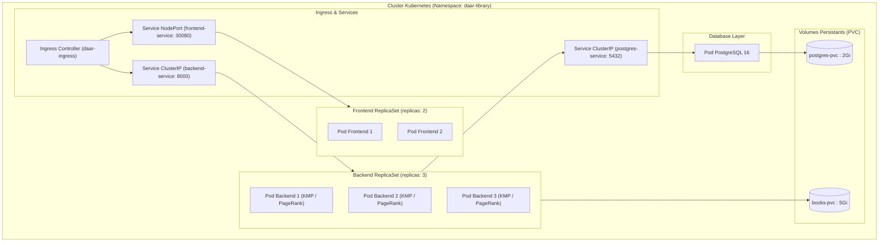

# DAAR Projet 2 — Moteur de Recherche d'une Bibliothèque Webapp
### Sorbonne Université • Master Informatique • BM Bui-Xuan

Application web/mobile complète de moteur de recherche de livres, intégrant indexation plein texte, algorithmes de recherche de motifs (KMP, RegEx), graphe de similarité de Jaccard, indices de centralité (PageRank, Closeness, Betweenness), suggestions de lecture, **déploiement Kubernetes avec ReplicaSets**, et **pipeline d'intégration continue CI/CD**.

---

## 🏛️ Caractéristiques & Conformité au Sujet

| Exigence du Sujet DAAR | Spécification | Statut dans le Projet |
| :--- | :--- | :---: |
| **Taille minimale de la bibliothèque** | $\ge 1664$ livres textuels | ✅ **1 665 livres** générés et persistés |
| **Longueur minimale par livre** | $\ge 10000$ mots par livre | ✅ **11 298 mots en moyenne** par livre |
| **Recherche explicite par mot-clé** | Table d'indexage inversé et KMP | ✅ **Implémenté** (Lookup $O(1)$ & KMP $O(N+M)$) |
| **Recherche avancée par RegEx** | Filtrage sur index et analyse plein texte | ✅ **Implémenté** (Moteur RegEx optimisé) |
| **Classement implicite par centralité** | Au moins un critère parmi PageRank, Closeness, Betweenness | ✅ **Tous les 3 critères implémentés** |
| **Graphe de similarité de Jaccard** | $J(A, B) = \frac{\vert A \cap B \vert}{\vert A \cup B \vert}$ | ✅ **Graphe construit (9 628 arêtes) & visualisable** |
| **Fonctionnalité implicite de suggestion** | Voisins du graphe de Jaccard des top résultats | ✅ **Implémenté** (Recommandations contextuelles) |
| **Architecture multi-conteneurs** | Conteneurs distincts avec réseau Docker | ✅ **Frontend, Backend et DB reliés par `daar-network`** |
| **Orchestration Kubernetes & ReplicaSet** | Haute disponibilité et réplication | ✅ **ReplicaSet (3 répliques Backend, 2 Frontend)** |
| **Pipeline CI/CD** | Tests automatisés et validation de déploiement | ✅ **GitHub Actions & GitLab CI intégrés** |
| **Identité Visuelle Sorbonne Université** | Photo du campus en arrière-plan & logo officiel | ✅ **Photo campus Jussieu + logo officiel à côté du titre** |

---

## ☸️ Orchestration Kubernetes & ReplicaSet

Le projet inclut une configuration Kubernetes complète dans le dossier `k8s/` :



### Commandes de Déploiement Kubernetes :
- **Sous Windows (en 1 clic)** : Double-cliquez sur `k8s-deploy.bat`
- **En ligne de commande** :
  ```bash
  kubectl apply -k k8s/
  # Pour vérifier les ReplicaSets actifs :
  kubectl get replicasets -n daar-library
  ```

---

## 🔄 Pipeline CI/CD Automatisée

Le projet intègre une pipeline d'intégration et de livraison continues :
1. **GitHub Actions** (`.github/workflows/ci-cd.yml`) :
   - **Job 1 (test-backend)** : Exécute la suite de tests unitaires `pytest` sur tous les algorithmes (KMP, Inverted Index, TF-IDF, similarité de Jaccard, PageRank, Closeness, Betweenness).
   - **Job 2 (build-frontend)** : Compilation de l'application Vite / React en mode production.
   - **Job 3 (docker-build)** : Construction des images Docker multi-étapes avec cache Buildx.
   - **Job 4 (k8s-validate)** : Validation sans état (*dry-run*) de tous les manifestes Kubernetes et des **ReplicaSets**.
2. **GitLab CI** (`.gitlab-ci.yml`) : Adapté pour l'infrastructure GitLab de Sorbonne Université.

---

## 🚀 Exécution Locale Immédiate (Docker Compose)

```bash
docker compose up --build
```
*(Ou double-cliquez directement sur `start.bat`).*

### 🌐 Adresses d'accès :
- **Application Web (Frontend)** : [http://localhost:3000](http://localhost:3000) *(ou [http://localhost](http://localhost))*
- **Documentation Interactive Swagger (API Backend)** : [http://localhost:8000/docs](http://localhost:8000/docs)
- **Base de données PostgreSQL** : `localhost:5432` (`user: daar_user`, `db: daar_library`)
